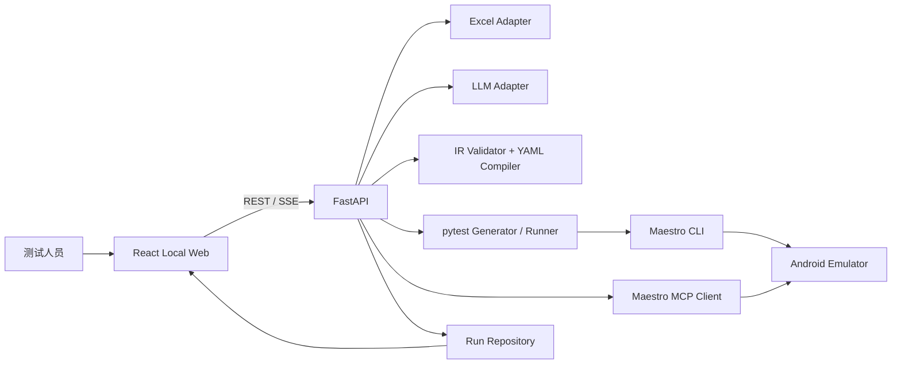

# Maestro + pytest + LLM APP 自动化测试平台技术设计

## 文档信息

| 项目 | 内容 |
| --- | --- |
| 版本 | V1.3.1 实施修订 |
| 状态 | V1.0 基线保留；本次兼容修订已实施，尚未完成发布验收 |
| 冻结日期 | 2026-09-16 |
| 需求基线 | `Maestro_pytest_LLM_APP自动化测试_正式需求文档_V1.0.md` |
| 研发计划 | `Maestro_pytest_LLM_APP自动化测试_一期研发任务与里程碑_V1.0.md` |
| 里程碑验收基线 | `docs/milestone-acceptance-v1.md` |
| 一期运行环境 | macOS、本地 Web、Android Studio 模拟器、Maestro CLI 2.10.0 |

本文档冻结一期的领域模型、目录结构、Flow IR、运行状态机和前后端接口。修改 Frozen 内容必须更新版本、影响分析和验收映射。

2026-10-19 配置/交付、2026-10-20 恢复及 2026-10-21 共享 Fixture 修订影响与验收映射见 [M4 实施记录](m4-implementation-status.md)、[重启恢复设计](m4-recovery-design.md)和[共享作用域设计](m4-shared-fixtures-design.md)。保留 Flow IR 1.0、REST API 1.2 和运行状态图；实现真实跨 Case module/session 生命周期、重试轮次重建及共享清理失败回溯。共享包增加 conftest、按 Case 模块分组的测试文件及文件请求/响应协议；纯 function 包兼容原执行路径。cleanup_result 可表达 pending/unknown，不新增顶层运行状态。各发布门禁仍须凭当前版本证据签收，技术修订不等于发布通过。

## 1. 设计目标

1. 模型生成内容与可执行内容隔离。LLM 只能生成受约束的 Flow IR，不能直接执行任意 YAML。
2. Excel、IR、YAML、pytest、执行尝试和证据通过稳定 ID 贯通。
3. pytest 是生命周期编排器；Maestro CLI 是正常执行器；Maestro MCP 是诊断和受控修复工具。
4. 源 Excel 只读。所有生成文件、日志和回写结果进入独立 Run 目录。
5. 单模拟器串行执行。运行状态持久化，页面刷新不丢失已完成信息。
6. 前端只通过版本化 API 操作后端，不直接访问本地文件或外部进程。

## 2. 技术决策

| 决策 | 选择 | 理由 |
| --- | --- | --- |
| 后端 | Python 3.11+、FastAPI、Pydantic v2 | 与 pytest、Excel 和进程编排生态一致；自动生成 OpenAPI |
| 前端 | React、TypeScript、Vite | 适合复杂预览、状态流和差异视图；类型可与 API 契约对齐 |
| 持久化 | 文件系统 Run Repository | 一期单机单用户，无需引入数据库；产物天然是文件 |
| 实时进度 | REST + Server-Sent Events | 本地单向事件流足够，重连和调试比 WebSocket 简单 |
| Excel | 适配层封装读写实现 | 避免领域层依赖具体库，保证源文件只读 |
| LLM 输出 | JSON Schema 约束的 Flow IR | 防止模型直接生成不可控 YAML |
| YAML | 确定性编译器 | 同一 IR 和编译器版本生成相同 YAML |
| 正常执行 | pytest 调用 Maestro CLI | 满足 Fixture 生命周期和报告要求 |
| 诊断修复 | Maestro MCP stdio | 获取设备、页面层级、截图并验证修复 |
| 并发 | 单 Run 执行锁，pytest worker=1 | 防止单模拟器状态竞争 |

## 3. 系统上下文



## 4. 目录结构

```text
maestro-llm-test-platform/
├── README.md
├── pyproject.toml
├── .env.example
├── docs/
│   ├── technical-design-v1.md
│   └── api-contract-v1.yaml
├── schemas/
│   └── flow-ir-v1.schema.json
├── backend/
│   ├── src/maestro_app/
│   │   ├── main.py
│   │   ├── api/v1/
│   │   │   ├── router.py
│   │   │   └── routes/
│   │   ├── application/
│   │   ├── domain/
│   │   │   ├── enums.py
│   │   │   ├── models.py
│   │   │   ├── flow_ir.py
│   │   │   └── state_machine.py
│   │   ├── infrastructure/
│   │   │   ├── run_repository.py
│   │   │   └── tool_probe.py
│   │   └── core/
│   │       └── config.py
│   └── tests/
│       ├── unit/
│       └── integration/
├── frontend/
│   ├── package.json
│   ├── vite.config.ts
│   └── src/
│       ├── api/
│       ├── components/
│       ├── features/
│       ├── types/
│       └── styles/
└── runtime/
    └── runs/<run_id>/
        ├── run.json
        ├── source/
        ├── generated/
        ├── reports/
        ├── artifacts/
        ├── repairs/
        └── result/
```

`runtime/` 不进入版本控制。每个 Run 的 `run.json` 是恢复状态的权威索引；大文件保留为独立文件，并由 Artifact 记录引用。

## 5. 分层和依赖规则

| 层 | 职责 | 允许依赖 |
| --- | --- | --- |
| Domain | 领域对象、枚举、IR、状态机、纯校验规则 | Python 标准库、Pydantic |
| Application | 用例服务、工作流编排、端口接口 | Domain |
| Infrastructure | Excel、文件系统、CLI、ADB、MCP、LLM 的具体适配器 | Application、Domain |
| API | HTTP/SSE 输入输出、鉴权占位、错误映射 | Application、Domain |
| Frontend | 用户交互、状态展示、预览、报告 | API 契约 |

Domain 不得导入 FastAPI、pytest、Excel 库、subprocess 或前端类型。

## 6. 领域模型

### 6.1 标识符

| 标识符 | 来源 | 规则 |
| --- | --- | --- |
| `workbook_id` | 系统 | ULID/UUID，标识一次导入快照 |
| `case_id` | Excel | 原值去除首尾空格后保持不变 |
| `fixture_id` | Excel | 原值去除首尾空格后保持不变 |
| `run_id` | 系统 | 时间有序唯一 ID，目录名使用该值 |
| `attempt_id` | 系统 | `<case_id>-a<序号>` |
| `artifact_id` | 系统 | Run 内唯一 ID |
| `repair_id` | 系统 | Run 内唯一 ID |

### 6.2 输入模型

#### WorkbookSnapshot

- `workbook_id`
- `source_filename`
- `source_sha256`
- `imported_at`
- `cases: list[TestCaseDefinition]`
- `fixtures: list[FixtureDefinition]`
- `config: ProjectConfig`
- `validation_issues: list[ValidationIssue]`

#### TestCaseDefinition

- `case_id`、`module`、`title`
- `pre_fixture_ids`、`post_fixture_ids`
- `priority`、`tags`、`enabled`
- `steps: list[SourceStep]`
- `expected_results: list[SourceStep]`
- `source_row`
- `note`

#### FixtureDefinition

- `fixture_id`、`title`、`phase`、`scope`、`module`
- `dependency_ids`、`order`、`enabled`
- `steps`、`expected_results`
- `source_row`

#### ProjectConfig

字段与 Config Sheet 一一对应。布尔值、整数和路径在进入领域层前完成类型转换；原始字符串仅保留在导入审计记录中。

### 6.3 生成模型

#### FlowIR

Flow IR 是 LLM 与可执行 YAML 之间的唯一接口，详细契约见 `schemas/flow-ir-v1.schema.json`。

- `schema_version`
- `flow_id`
- `flow_kind: case | fixture`
- `app_id`
- `name`
- `tags`
- `properties`
- `commands: list[CommandIR]`
- `generation_context`

#### GeneratedFlow

- `flow_id`
- `ir_path`
- `initial_yaml_path`
- `final_yaml_path`
- `compiler_version`
- `prompt_version`
- `generation_status`
- `warnings`

### 6.4 执行模型

#### Run

- `run_id`、`workbook_id`、`mode`
- `state`、`created_at`、`updated_at`
- `selected_case_ids`
- `config_snapshot`
- `case_runs`
- `events_cursor`
- `terminal_reason`

#### CaseRun

- `case_id`
- `state`
- `fixture_plan`
- `attempts`
- `business_result`
- `cleanup_result`
- `started_at`、`ended_at`、`duration_seconds`

#### Attempt

- `attempt_id`、`ordinal`
- `state`
- `failure_type`
- `failed_step`
- `exit_code`
- `artifact_ids`
- `repair_id`

#### RepairRecord

- `repair_id`
- `failure_type`
- `evidence_artifact_ids`
- `reason`
- `before_selector`
- `after_selector`
- `yaml_diff_path`
- `approved_automatically`

#### Artifact

- `artifact_id`
- `kind`
- `relative_path`
- `media_type`
- `sha256`
- `case_id`、`attempt_id`
- `created_at`

### 6.5 校验模型

ValidationIssue 必须包含：

- `code`
- `severity: error | warning`
- `message`
- `sheet`
- `row`
- `column`
- `entity_id`
- `field`
- `suggestion`

任何 `error` 阻止生成。按后续已冻结的 M4-AC-01 门禁，含 `warning` 的 Flow 在两种模式下均需人工确认；不能仅因语法通过自动批准。`approval_method=manual` 记录确认来源；旧版带 warning 且无人工确认来源的批准需重新复核。本条覆盖 V1.0“无人值守记录后继续”的旧文字，保留 warning 证据与原请求模式。

## 7. Flow IR V1

### 7.1 设计原则

- 使用带判别字段 `type` 的命令联合类型。
- 每条命令必须包含 `source_ref`，可回溯到 Excel 原文。
- 选择器采用结构化 `strategy + value`，Schema 中不存在坐标字段。
- 断言命令显式标记 `assertion=true`，修复器不得修改其业务目标。
- `run_flow` 只引用系统生成的 Flow ID 或受控相对路径。
- 模型无法表达的命令必须失败，不允许透传原始 YAML。

### 7.2 SelectorIR

```json
{
  "strategy": "text | resource_id | content_description",
  "value": "非空字符串",
  "index": 0
}
```

`index` 可选，必须来自页面层级证据或用例中的明确区分信息。

Flow IR V1 的 `value` 表示字面控件值，不向 Excel/LLM 暴露正则语义。由于 Maestro 文本和 ID 选择器底层按正则解释，YAML 编译器必须在输出边界转义正则元字符；例如控件文案 `确认设置(1)` 编译为可匹配字面括号的 `确认设置\\(1\\)`。

### 7.3 CommandIR

一期允许的 `type`：

- `launch_app`
- `clear_state`
- `tap_on`
- `input_text`
- `erase_text`
- `assert_visible`
- `assert_not_visible`
- `scroll_until_visible`
- `swipe`
- `back`
- `hide_keyboard`
- `wait_for_animation`
- `run_flow`
- `take_screenshot`

每条命令必须通过 JSON Schema 和 Pydantic 双重校验后，才能交给 YAML Compiler。

### 7.4 不变量

1. `flow_id` 与源 Case/Fixture ID 一致。
2. `app_id` 来自 Config，不接受 LLM 自行填写。
3. Case 的预期结果只能生成断言命令。
4. 修复器不能删除命令、改变命令顺序、改变输入数据或修改断言目标。
5. 自动修复只能替换失败操作命令的 SelectorIR。
6. 编译器拒绝未知字段和未知命令类型。

## 8. 运行状态机

### 8.1 RunState

```text
CREATED
  → VALIDATING → VALIDATION_FAILED
  → GENERATING → GENERATION_FAILED
  → AWAITING_REVIEW → READY
  → PREPARING_DEVICE
  → RUNNING ↔ DIAGNOSING → REPAIRING → RUNNING
  → FINALIZING
  → COMPLETED | COMPLETED_WITH_FAILURES | FAILED | CANCELLED
```

### 8.2 状态说明

| 状态 | 含义 | 可离开到 |
| --- | --- | --- |
| CREATED | Run 已创建，尚未处理 | VALIDATING、CANCELLED |
| VALIDATING | 校验 Excel 和配置 | GENERATING、VALIDATION_FAILED、CANCELLED |
| VALIDATION_FAILED | 存在阻断校验错误 | 终态 |
| GENERATING | 生成 IR/YAML/pytest | AWAITING_REVIEW、READY、GENERATION_FAILED、CANCELLED |
| GENERATION_FAILED | 生成或语法修复失败 | 终态 |
| AWAITING_REVIEW | 等待人工确认 | READY、CANCELLED |
| READY | 已批准，等待设备准备 | PREPARING_DEVICE、CANCELLED |
| PREPARING_DEVICE | 选择/启动设备并检查应用 | RUNNING、FAILED、CANCELLED |
| RUNNING | 执行 Fixture 或 Case | DIAGNOSING、FINALIZING、FAILED |
| DIAGNOSING | 分类失败并收集证据 | REPAIRING、RUNNING、FINALIZING、FAILED |
| REPAIRING | 生成并校验受控补丁 | RUNNING、FINALIZING、FAILED |
| FINALIZING | 执行必要清理、聚合报告并写回结果 | COMPLETED、COMPLETED_WITH_FAILURES、FAILED、CANCELLED |
| COMPLETED | 全部启用 Case 通过 | 终态 |
| COMPLETED_WITH_FAILURES | 流程完成但存在失败/阻断 Case | 终态 |
| FAILED | Run 级不可恢复错误 | 终态 |
| CANCELLED | 用户或系统取消 | 终态 |

### 8.3 状态机规则

- 所有转换由 Domain StateMachine 校验，API 不得直接赋值。
- 每次转换写入不可变 RunEvent，并原子更新 `run.json`。
- Run 终态不可再次进入运行态；重新运行必须创建新 Run。
- 浏览器关闭不改变 Run 状态。
- 后端重启时读取 `run.json`：终态保持；非终态转入恢复检查，不自动重放外部操作。
- V1.2 恢复实现：Web 启动、新建 Run 前及恢复延迟后的状态查询取得 runtime 文件锁；工作进程守护共享锁至清理结束。非终态按现有状态图安全终止，导出 pending 独立标记失败，保留恢复前快照和哈希报告。旧版所有权不明记录阻断新执行，须人工核查后明确确认。详见恢复设计；内部 Run 新增可选 `execution_ownership=guarded-v1`，REST RunSummary 增量加入可空的恢复报告/快照 Artifact ID，状态图不变。
- 执行前取消可直接进入 `CANCELLED`。执行开始后的取消只设置 `cancel_requested`，停止当前子进程后进入 `FINALIZING`；已建立的清理义务完成后才进入 `CANCELLED`。

### 8.4 CaseRunState

`PENDING → SETTING_UP → RUNNING → TEARING_DOWN → PASSED | FAILED | BLOCKED | FIXTURE_FAILED | ENV_ERROR | TIMEOUT`

`SETTING_UP` 失败进入 `BLOCKED`，但仍清理已成功建立的 Fixture。业务断言失败进入 `FAILED`，不能进入自动断言修复。

## 9. 前后端 API V1

完整机器可读契约见 `docs/api-contract-v1.yaml`。所有响应包含 `request_id` 响应头；错误使用统一 Problem 对象。

### 9.1 M0 已实现接口

| 方法 | 路径 | 用途 |
| --- | --- | --- |
| GET | `/api/v1/health` | 服务健康、版本和契约版本 |
| GET | `/api/v1/system/capabilities` | Maestro、ADB、AVD、设备、MCP 和应用包探测 |
| GET | `/api/v1/schema/flow-ir` | 获取冻结的 Flow IR V1 Schema |

### 9.2 M1 接口

| 方法 | 路径 | 用途 |
| --- | --- | --- |
| POST | `/api/v1/workbooks` | 上传工作簿并创建只读快照 |
| GET | `/api/v1/workbooks/{workbook_id}` | 查询解析摘要 |
| GET | `/api/v1/workbooks/{workbook_id}/validation` | 查询校验问题 |
| POST | `/api/v1/generations` | 生成 IR、YAML 和 pytest 预览 |
| GET | `/api/v1/generations/{generation_id}` | 查询生成状态和条目 |
| GET | `/api/v1/generations/{generation_id}/flows/{flow_id}` | 查询步骤映射、警告和 YAML |
| POST | `/api/v1/generations/{generation_id}/approval` | 人工逐项或批量批准 |

### 9.3 M2/M3 接口

| 方法 | 路径 | 用途 |
| --- | --- | --- |
| POST | `/api/v1/runs` | 从已生成内容创建 Run |
| GET | `/api/v1/runs/{run_id}` | 查询 Run 和 Case 摘要 |
| GET | `/api/v1/runs/{run_id}/events` | SSE 进度和状态事件 |
| POST | `/api/v1/runs/{run_id}/cancel` | 请求安全终止 |
| GET | `/api/v1/runs/{run_id}/cases/{case_id}` | 查询 Case、尝试和修复详情 |
| GET | `/api/v1/runs/{run_id}/artifacts/{artifact_id}` | 下载受控产物 |
| GET | `/api/v1/runs/{run_id}/result-workbook` | 下载结果 Excel |

### 9.4 统一错误对象

```json
{
  "code": "VALIDATION_FAILED",
  "message": "工作簿包含阻断错误",
  "request_id": "...",
  "details": [],
  "retryable": false
}
```

HTTP 状态约定：

- 400：请求格式或业务参数错误。
- 404：资源不存在。
- 409：状态冲突或重复操作。
- 422：Schema 校验失败。
- 500：未知内部错误。
- 503：Maestro、ADB、MCP 或 LLM 暂不可用。

## 10. SSE 事件契约

事件包含：

- `event_id`
- `run_id`
- `sequence`
- `type`
- `occurred_at`
- `entity_type`
- `entity_id`
- `state`
- `message`
- `data`

一期事件类型：`run.state_changed`、`case.state_changed`、`fixture.state_changed`、`attempt.started`、`attempt.finished`、`repair.created`、`artifact.created`、`log.message`。

客户端用 `Last-Event-ID` 重连；服务端从持久化事件序号继续发送，不能只依赖内存队列。

## 11. 文件和原子性

- 上传后立即计算源文件 SHA-256 并复制到 Run/Workbook 快照目录。
- 后续解析只读取快照，不读取用户原始路径。
- JSON 状态先写临时文件，再用原子替换更新。
- Artifact 路径必须是 Run 根目录下的相对路径，拒绝 `..` 和绝对路径。
- 结果 Excel 写入临时文件，重读校验后再原子改名。
- 日志不得打印 API Key；一期不承诺对 Excel 内测试账号脱敏。

## 12. 外部进程规则

- 统一 ProcessRunner 设置命令、工作目录、环境白名单、超时和输出上限。
- 不通过 shell 拼接用户输入；命令参数使用数组传递。
- 记录可执行文件解析结果和版本。
- 子进程取消先发送温和终止，超时后再强制结束。
- Maestro MCP 使用独立 stdio 生命周期管理器，JSON-RPC 请求按 ID 对应响应。
- V1.3.1（2026-10-22）仅收紧诊断证据边界：解析结构化设备列表并精确匹配在线 Android 模拟器 ID；截图须为可完整解码、声明一致的单帧 PNG/JPEG，按真实格式保存，限制 16 MiB/1600 万像素/单边 8192。证据不合格时停止自动修复、保留诊断错误，不修改 YAML 或增加修复 Attempt。新增 Pillow 依赖；不改领域模型、目录主结构、IR Schema、REST API 和运行状态图。实现、兼容性和验收映射见 [小范围收尾记录](m4-small-closeout-20261022.md)。

## 13. 前端设计规范

设计方向为工业测试控制台：深石墨背景、暖橙色操作强调、薄荷绿健康状态和高密度但清晰的诊断信息。

- 主字体优先 Avenir Next，遥测和 ID 使用 SFMono/IBM Plex Mono。
- 页面首屏优先显示环境状态、当前里程碑和关键动作。
- 状态不仅依赖颜色，同时显示文字和符号。
- 运行时间线、错误证据和修复差异使用稳定的左右关系，避免卡片堆叠造成信息割裂。
- 动效只用于状态变化和页面进入，不影响日志阅读。
- 支持键盘焦点、对比度和 `prefers-reduced-motion`。

## 14. M0 完成标准

- 技术设计、API 契约和 Flow IR Schema 状态为 Frozen V1。
- 前后端可分别启动，前端能调用健康和能力探测接口。
- 后端领域模型和状态机具有单元测试。
- 系统能探测 Maestro 版本、ADB、在线设备、AVD、MCP 能力和目标应用包。
- Flow IR Schema 可通过 API 获取，且 Pydantic 模型拒绝坐标和未知命令。
- README 提供本地启动和测试命令。

## 15. 变更控制

以下变更必须升级契约版本：

- 删除或重命名 API 字段、状态或 IR 命令类型。
- 改变状态终态含义或允许的转换。
- 允许新的选择器类别或新增可执行命令。
- 改变 Run 目录中权威状态文件的位置或格式。

新增可选字段且旧客户端可忽略时可保持 V1，但必须同步更新 JSON Schema、Pydantic 模型、OpenAPI 契约和前端类型。
